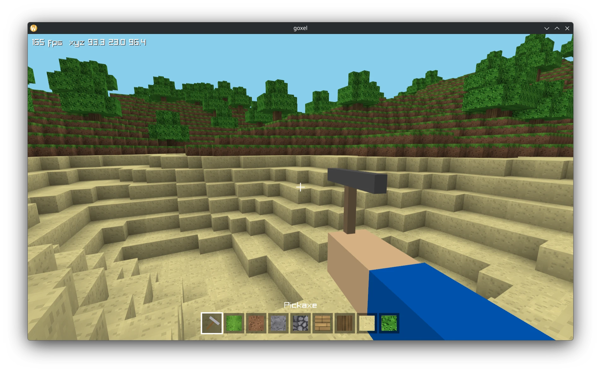

# goxel (Go)

A small Minecraft style voxel game written in Go with raylib. It's an
experiment to test generating everything including textures through
procedural (noise noise noise) generation.



## Build

Needs Go 1.27 and a C compiler, since raylib is built from source through cgo.
 On Linux install the X11 or Wayland development headers and OpenGL.

```sh
make run        # Build and run
make release    # Stripped binary
make test       # Unit tests
make texview    # Browse the generated textures
```

Without `make`, use `go run .`, `go build` and `go test ./...`.

## Controls

| Input                 | Action                                            |
| --------------------- | ------------------------------------------------- |
| W A S D               | Move                                              |
| Mouse                 | Look                                              |
| Space                 | Jump (fly up while flying)                        |
| Left Shift            | Fly down                                          |
| Left Ctrl             | Sprint                                            |
| F                     | Toggle flying                                     |
| Left click (hold)     | Mine the targeted block, cracks show the progress |
| Right click           | Place the held block                              |
| 1 to 9 or mouse wheel | Select pickaxe or block                           |
| F3                    | Toggle debug text                                 |
| Esc                   | Quit                                              |

## Noise

Terrain and textures use FastNoiseLite, vendored unmodified in 
`internal/fastnoise`. The terrain is fractal OpenSimplex2 noise. Each 16 by 16
texture tile is painted from fractal value noise that repeats every tile, so
neighbouring blocks join without seams. Cobblestone adds warped Voronoi cells
with mortar lines.

## Textures

All block textures are generated at startup in `textures.go`, with no image
files. The world draws them from an OpenGL array texture with one layer per
tile, so filtering and mipmaps never bleed between neighbouring tiles. A
packed atlas is kept for the hotbar icons and the held block.

Textures can be visualized through `cmd/texview`. Or simply run `make texview`
